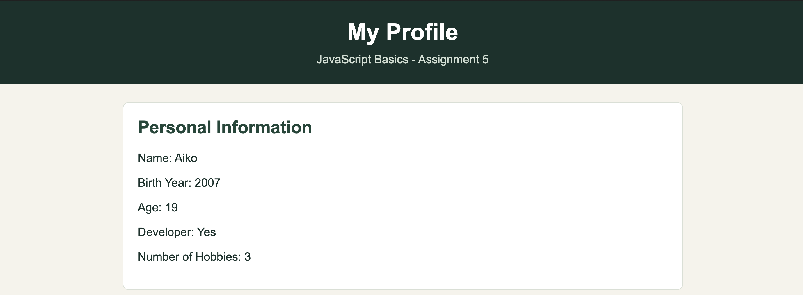
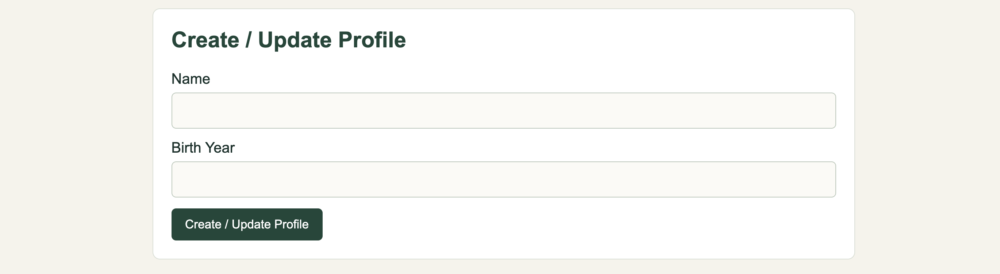
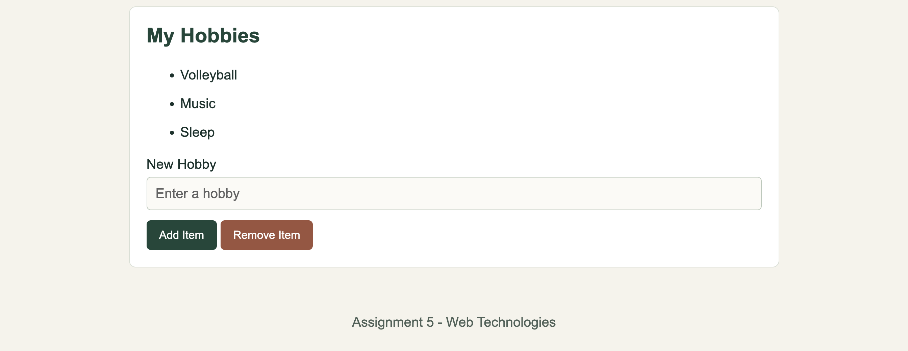

# Assignment #5 — JavaScript Basics

**Name:** Aikyn Sabit  
**Group:** IT-2504

## Task 1 — Profile Object and Calculations

Created a `userProfile` object with different data types, including a string, number, boolean and array. Calculated the user's age and hobbies count.

## Task 2 — Form Input and Events

Created a form with Username and Birth Year fields. Used an event listener to update the profile when the form is submitted.

## Task 3 — DOM List Manipulation

Created a hobbies list with Add Item and Remove Item buttons. Used JavaScript to add new hobbies and remove the last item.

## Summary

During this assignment, I practiced JavaScript objects, arithmetic operations, event listeners and DOM manipulation. I also added functions to update the profile and manage the hobbies list.

## Technologies Used

- HTML5
- CSS3
- JavaScript

## Link to Website

(https://aikynsabit077.github.io/WEB5ASIK/)
